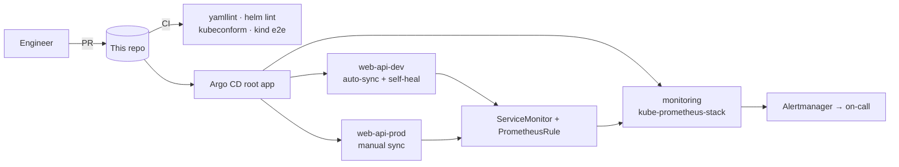

# k8s-gitops-argocd

[](https://github.com/Captainpeace6/k8s-gitops-argocd/actions/workflows/ci.yml)

GitOps delivery for Kubernetes with Argo CD. A hardened Helm chart for a stateless HTTP service, deployed to `dev` and `prod` namespaces through an app-of-apps, with Prometheus monitoring and alerting from `kube-prometheus-stack`. Every change is rendered, schema-checked and deployed to a real kind cluster in CI before it can merge.

The sample workload is [podinfo](https://github.com/stefanprodan/podinfo), a small Go service with health checks and Prometheus metrics built in.

## How it fits together



## Repo layout

| Path | What |
|---|---|
| `charts/web-api/` | Helm chart: Deployment, Service, HPA (CPU + memory), PDB, NetworkPolicy, Ingress, ServiceMonitor, PrometheusRule |
| `charts/web-api/values-{dev,prod}.yaml` | Per-environment sizing, replicas, alerting |
| `argocd/bootstrap/root.yaml` | App of apps. Apply it once and Argo CD manages everything else from Git |
| `argocd/apps/` | One `Application` per workload; prod syncs only after a manual approval |
| `argocd/projects/platform.yaml` | `AppProject` restricting source repos, namespaces and cluster-scoped kinds |
| `monitoring/values.yaml` | Prometheus retention and storage, Alertmanager routing, Grafana from an existing secret |
| `docs/runbooks/oomkilled.md` | What to do when `WebApiOOMKilled` fires |

## Hardening in the chart

- Runs as non-root (UID 10001) with a read-only root filesystem, all capabilities dropped, and the seccomp `RuntimeDefault` profile
- No service account token mounted, since the app doesn't call the Kubernetes API
- `maxUnavailable: 0` rolling updates, a PodDisruptionBudget, and spread across zones and nodes
- Memory **limit** set with no CPU limit, so the app isn't throttled while the OOM boundary stays explicit
- NetworkPolicy lets only the same namespace, ingress-nginx and monitoring reach the pods
- The HPA scales down at most 50% per minute after a 5-minute stabilization window, so it doesn't flap

## Alerts

| Alert | Fires when | Severity |
|---|---|---|
| `WebApiHighErrorRate` | over 5% of requests return 5xx for 10 minutes | page |
| `WebApiOOMKilled` | a container restarted after an OOM kill | ticket, links to the runbook |
| `WebApiAtMaxReplicas` | the HPA has been at max replicas for 15 minutes | ticket |

## CI

1. `yamllint`, then `helm lint --strict` for each environment's values
2. `helm template` → `kubeconform -strict`, validating against Kubernetes schemas and CRD schemas (ServiceMonitor, PrometheusRule, Argo CD `Application`/`AppProject`)
3. Spins up a **kind** cluster, installs the chart with prod values, curls `/healthz`, `/readyz` and `/metrics` from a pod inside the cluster, then runs a rolling upgrade and waits for it to complete

## Run it yourself

```bash
kind create cluster
kubectl create ns argocd
kubectl apply -n argocd -f https://raw.githubusercontent.com/argoproj/argo-cd/stable/manifests/install.yaml
kubectl create ns monitoring
kubectl -n monitoring create secret generic grafana-admin \
  --from-literal=admin-user=admin --from-literal=admin-password="$(openssl rand -hex 16)"
kubectl apply -f argocd/projects/platform.yaml
kubectl apply -f argocd/bootstrap/root.yaml
kubectl -n argocd get applications -w
```
